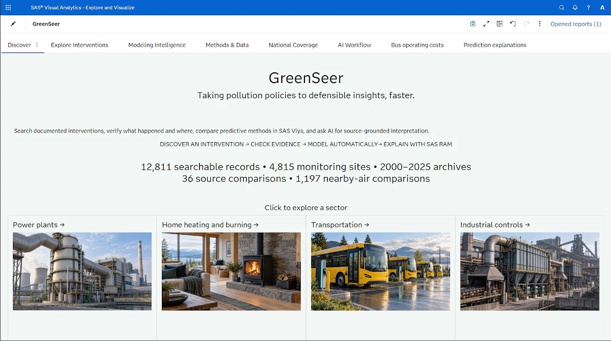
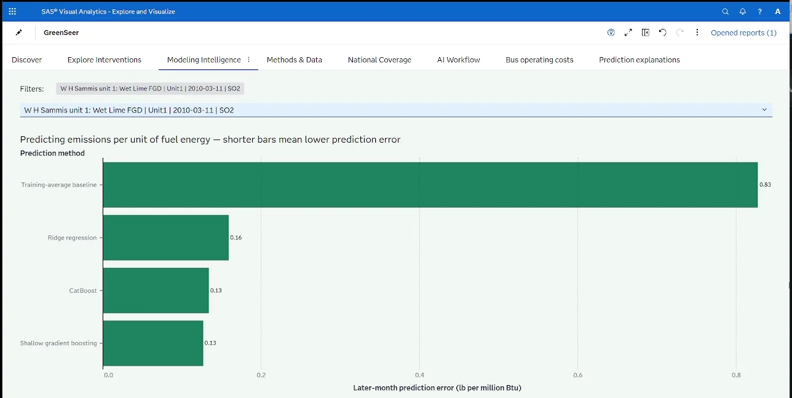
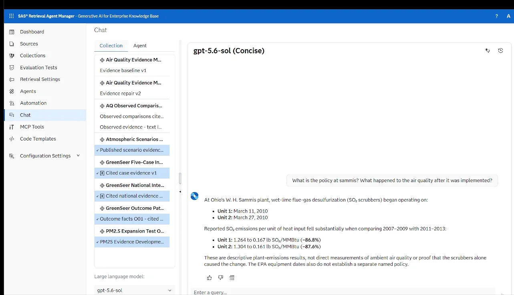
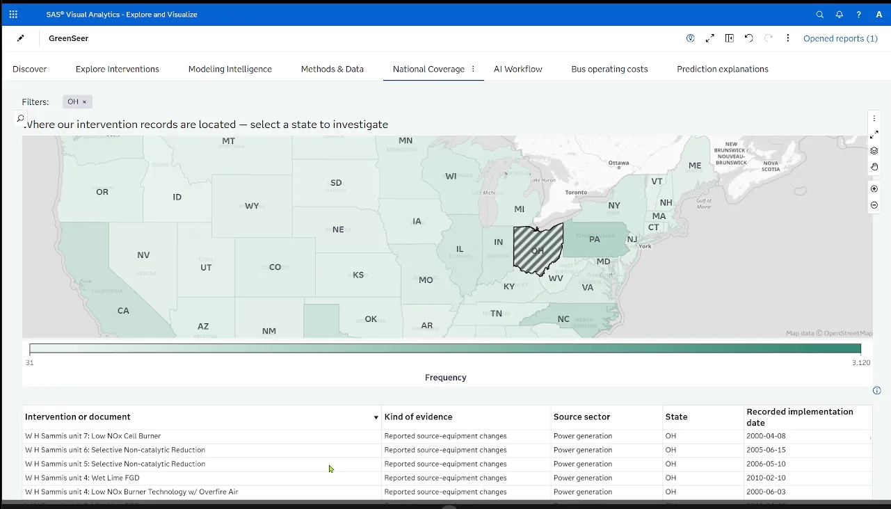

# GreenSeer

**GreenSeer is an auto-ML-inspired environmental intervention intelligence system that turns documented pollution interventions into evidence-matched, reproducible analytical workflows.**

The project was created by **Ludlowe Legacy** for the 2026 SAS Hackathon Healthcare & Life Sciences track: **Andrew Kutsch, Gamid Muratbekov, and Adil Syed**.

GreenSeer does not apply one model to every policy. It structures an intervention, checks what outcome data exist, routes the case through explicit eligibility rules, compares approved methods on a shared evaluation period, and keeps the evidence type and claim boundary beside the result.

## Project at a glance

- **12,811 searchable intervention and evidence records** in the retained discovery library—not 12,811 measured policy effects.
- **4,815 EPA ambient monitoring sites** represented in the retained archive.
- **36 completed source-level intervention comparisons** in the national power-sector expansion.
- **1,197 retained intervention-to-nearby-air comparison links** for further screening, not 1,197 causal estimates.

The public portfolio includes four documented cases across power generation, residential combustion, transportation, and industry. Its reproducible example calculates the observed sulfur-dioxide emissions intensity at one W. H. Sammis generating unit before and after a reported scrubber start: **1.264 to 0.167 lb SO2/MMBtu**, an **86.82% observed decrease**. That is a source-level descriptive result, not an 86.82% decline in surrounding air pollution and not an isolated causal effect.

## What is implemented

### Implemented

- A responsive GitHub Pages portfolio driven by checked-in compact data.
- Deterministic, auditable routing between a source-intensity template, an ambient descriptive template, review, and insufficient-evidence status.
- A reproducible source-intensity calculation from monthly EPA power-sector records.
- Held-out model comparison for the Sammis source-intensity case using a training-average baseline, ridge regression, histogram gradient boosting, and CatBoost.
- A completed hackathon dashboard in SAS Visual Analytics and cited explanations in SAS Retrieval Agent Manager (RAM). The hackathon tenant is no longer live; screenshots document that implementation.

### Prototype

- Language-model-assisted intervention interpretation was explored as a structured extraction and explanation layer. The public router itself is deterministic; it does not ask a generative model to invent statistical methods.
- Ambient and cross-sector case templates demonstrate the common evidence contract, but their descriptive results are not automatically comparable causal effects.

### Future scope

- Reconstruct more verified operational dates, exposure footprints, adoption and operating intensity.
- Add approved transportation and residential templates with sector-specific data and validation.
- Estimate health impacts only when a defensible ambient concentration and exposure pathway exists.

## Quick start

Requirements: Python 3.11+; no third-party Python packages are required for the public example.

```powershell
git clone https://github.com/OWNER/greenseer-environmental-intelligence.git
cd greenseer-environmental-intelligence
python -m unittest discover -s tests -v
python examples/run_sammis_example.py
python -m http.server 8000 --directory docs
```

Then open `http://127.0.0.1:8000/`.

## Repository map

| Path | Purpose |
| --- | --- |
| `docs/` | GitHub Pages site, compact public data, methods and screenshots |
| `src/greenseer_public/` | Typed contracts, deterministic router and transparent calculation |
| `examples/` | Executable Sammis reproduction |
| `scripts/` | Public-data build and release audit |
| `tests/` | Data, routing, calculation, site and documentation contracts |
| `media/` | Provenance manifest for the optimized public screenshots |

## SAS Viya

SAS Viya was central to the hackathon implementation. SAS Visual Analytics provided sector discovery, state maps, filters, intervention drill-down, model comparison and prediction-explanation views. Python workflows supplied compact analytical tables. SAS RAM supplied source-grounded explanations from curated collections. RAM explained evidence; it did not replace the analytical model or certify causality.

See [SAS Viya implementation](docs/sas-viya-implementation.md) and [architecture](docs/architecture.md).

## SAS Viya screenshots

| Discovery and sector exploration | Model comparison |
| --- | --- |
|  |  |

| Cited explanation | National coverage |
| --- | --- |
|  |  |

## Data sources

The retained project used EPA Clean Air Markets Program Data (CAMPD), EPA Air Quality System (AQS) AirData, NOAA National Centers for Environmental Information weather products, the U.S. Department of Energy Alternative Fuels Data Center, federal and state records, and original studies. See [data sources](docs/data-sources.md) for roles and public links.

## Limitations

- A searchable record is not the same as a verified implementation or measured effect.
- Observed source changes, observed ambient changes, adjusted predictive associations, causal estimates, and hypothetical scenarios are different evidence classes.
- SHAP values explain model predictions; they do not prove that a feature caused the observed pollution change.
- The public repository contains compact derived artifacts rather than the complete private raw-data archive.
- The displayed cross-sector results use different outcomes and units and must not be collapsed into a national causal ranking.

See [evidence and limitations](docs/evidence-and-limitations.md).

## License and citation

Code and original documentation are released under the [MIT License](LICENSE). Government source data and cited studies retain their original terms. Use [CITATION.cff](CITATION.cff) to cite this repository.
